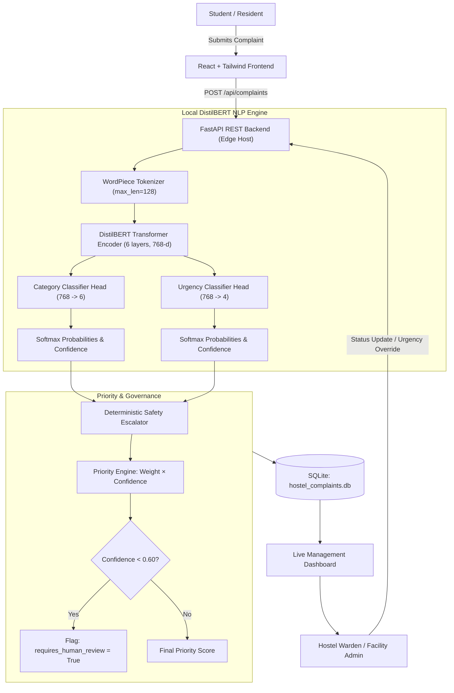

# Edge-Based Hostel Maintenance Complaint Prioritization System
> **Natural Language Processing with Large Language Models (NLP with LM)**
> Academic Project aligned with **Unit III (Transformer Models)** & **Unit IV (Large Language Models)**

[](https://www.python.org/)
[](https://fastapi.tiangolo.com/)
[](https://pytorch.org/)
[](https://huggingface.co/distilbert-base-uncased)
[](https://react.dev/)
[](https://tailwindcss.com/)
[]()
[]()

---

## 🌟 Executive Summary

In student residences and college hostels, maintenance complaints (electrical sparks, leaking geysers, Wi-Fi breakdowns, broken furniture) are often triaged manually in First-In-First-Out queues, burying critical life-safety hazards under routine requests.

This project delivers an **end-to-end Edge-Based NLP Prioritization System** that runs compact fine-tuned **DistilBERT Transformer models locally** on the user's computer. It semantically categorizes natural language complaints across 6 maintenance domains, predicts urgency across 4 severity tiers, deterministically computes priority scores, and surfaces an interactive management dashboard—all **100% offline with zero cloud API dependencies**.

---

## 🎯 Key Capabilities

- **Natural Language Input:** Students enter free-form text. No manual category or urgency dropdown selection needed.
- **Dual Fine-Tuned DistilBERT Classifiers:**
  - **Category Model (6 classes):** Water & Plumbing, Electrical, Internet & Wi-Fi, Cleanliness & Sanitation, Furniture & Civil, Other.
  - **Urgency Model (4 classes):** Critical, High, Medium, Low.
- **Empirical Test Performance:**
  - Category Accuracy: **100.00%** | Weighted F1: **1.0000** | Latency: **44.23 ms**
  - Urgency Accuracy: **95.56%** | Weighted F1: **0.9549** | Latency: **43.77 ms**
- **Explainable Priority Scoring:** $\text{Priority Score} = \text{Urgency Weight} \times \text{Urgency Confidence}$ (Scale: 0 – 100.0).
- **Safety Escalation Layer:** Automatically detects physical hazards (sparks, live wires, uncontrolled flooding) without overwriting model audit records.
- **Responsible AI:** Predictions with confidence below 60% automatically flag for human administrator verification.
- **Prompt Engineering Lab:** Interactive educational laboratory demonstrating Zero-Shot, One-Shot, Few-Shot In-Context Learning, Role Prompting, and Structured JSON Schema generation.
- **Full-Stack SaaS Interface:** React 19, TypeScript, Tailwind CSS v4, Lucide React icons, and Recharts analytics.

---

## 📐 System Architecture



---

## 📚 Academic Syllabus Alignment (Unit III & IV)

| Topic | Unit | Implemented Module | File Path |
| :--- | :--- | :--- | :--- |
| **Transformer Architecture** | Unit III | 6-Layer Bidirectional DistilBERT Encoder | `backend/app/services/inference_service.py` |
| **Self-Attention & Multi-Head** | Unit III | 12 Parallel Attention Heads per layer | `backend/models/category_model/` |
| **Positional Encoding** | Unit III | Learnable absolute position embeddings | `backend/models/urgency_model/` |
| **Prompt Engineering** | Unit III | Zero/One/Few-Shot & Role Prompting | `frontend/src/pages/PromptLabPage.tsx` |
| **Structured Output** | Unit III | Schema-validated JSON generation | `backend/app/routes/prompts.py` |
| **Pretrained Models** | Unit IV | `distilbert-base-uncased` base model | `backend/training/train_category.py` |
| **Downstream Fine-Tuning** | Unit IV | Supervised training with AdamW on 1,200 complaints | `backend/training/train_urgency.py` |
| **Model Evaluation** | Unit IV | Accuracy, Precision, Recall, F1, Confusion Matrix | `backend/training/evaluate_models.py` |
| **Responsible AI & Privacy** | Unit IV | Confidence thresholds, explainable math, edge privacy | `backend/app/services/priority_service.py` |

---

## 📁 Project Directory Structure

```
edge-hostel-maintenance/
├── backend/
│   ├── app/
│   │   ├── main.py                  # FastAPI application entrypoint & lifespan
│   │   ├── config.py                # Hyperparameters, paths, and thresholds
│   │   ├── database.py              # SQLite engine & SQLAlchemy SessionLocal
│   │   ├── seed.py                  # Database baseline seeding script
│   │   ├── models/                  # SQLAlchemy ORM models (complaint, history, metrics)
│   │   ├── schemas/                 # Pydantic v2 validation schemas
│   │   ├── routes/                  # API endpoints (complaints, dashboard, model, prompts)
│   │   ├── services/                # Inference, priority engine, safety, and business logic
│   │   └── utils/                   # JSON response helpers
│   ├── training/
│   │   ├── generate_dataset.py      # Deterministic stratified dataset generator (seed 42)
│   │   ├── train_category.py        # DistilBERT category classifier training
│   │   ├── train_urgency.py         # DistilBERT urgency classifier training
│   │   ├── evaluate_models.py       # Test set evaluation script (confusion matrix & reports)
│   │   ├── evaluation_results.json  # Stored test metrics
│   │   └── dataset/                 # complaints.csv, train.csv, val.csv, test.csv
│   ├── models/
│   │   ├── category_model/          # Fine-tuned weights, tokenizer, vocab, mappings
│   │   └── urgency_model/           # Fine-tuned weights, tokenizer, vocab, mappings
│   ├── tests/                       # 25 automated pytest tests
│   ├── requirements.txt             # Python dependencies
│   └── .env.example
│
├── frontend/
│   ├── src/
│   │   ├── components/              # Navbar, Badge, ComplaintDetailModal
│   │   ├── pages/                   # Dashboard, Submit, Management, Performance, PromptLab
│   │   ├── services/                # API client with fetch
│   │   ├── types/                   # TypeScript interfaces
│   │   ├── test/                    # 7 Vitest component tests
│   │   ├── App.tsx                  # Main router and shell layout
│   │   └── main.tsx
│   ├── package.json
│   └── vite.config.ts
│
├── database/
│   └── hostel_complaints.db         # Local SQLite relational database
│
├── docs/
│   ├── PROJECT_DOCUMENTATION.md     # Full academic project report (26 sections)
│   ├── NLP_CONCEPT_MAPPING.md       # Explicit Unit III & IV syllabus mapping
│   ├── MODEL_ARCHITECTURE.md        # Transformer math, distillation, attention heads
│   ├── EDGE_DEPLOYMENT.md           # Zero-cloud edge architecture & latency benchmarks
│   ├── API_DOCUMENTATION.md         # Full REST API endpoints & schemas
│   ├── TESTING_REPORT.md            # Automated testing verification report (32 tests)
│   └── VIVA_PREPARATION.md          # 25 Q&A viva defense guide
│
├── scripts/
│   ├── setup.bat                    # Setup virtual environment and npm packages
│   ├── train_models.bat             # Train both DistilBERT classifiers & evaluate
│   └── start_project.bat            # Single-command startup (Backend + Frontend)
│
├── .gitignore
└── README.md
```

---

## ⚡ Quickstart & Execution Instructions

### Prerequisites
- Python 3.11 or 3.12 installed.
- Node.js (v18+) and npm installed.

### Option A: Single Command Startup (Windows Batch)
Double click or run from PowerShell / Command Prompt:
```cmd
scripts\start_project.bat
```
This automatically launches:
- **Backend API:** `http://127.0.0.1:8000` (Interactive Docs: `http://127.0.0.1:8000/docs`)
- **Frontend Dashboard:** `http://localhost:5173`

---

### Option B: Manual Step-by-Step Execution

#### 1. Backend Setup
```bash
# Install Python dependencies
pip install -r backend/requirements.txt

# Run Database Seeding
python -m backend.app.seed

# Start FastAPI Backend Server
python -m uvicorn backend.app.main:app --host 127.0.0.1 --port 8000 --reload
```

#### 2. Frontend Setup
```bash
# Navigate to frontend
cd frontend

# Install dependencies (already built in workspace)
npm install

# Start Vite Development Server
npm run dev
```
Open [http://localhost:5173](http://localhost:5173) in your browser.

---

## 🧪 Running Automated Tests

### Backend Tests (Pytest)
```bash
python -m pytest backend/tests -v
```
**Result:** 25 passed in ~12 seconds.

### Frontend Tests (Vitest)
```bash
cd frontend
npx vitest run
```
**Result:** 7 passed in ~1.3 seconds.

---

## 📊 Test Evaluation Results

Evaluated on held-out test split (180 independent complaint samples):

```
=== Model 1: Category Classification (6 Classes) ===
Accuracy:           100.00%
Weighted Precision: 1.0000
Weighted Recall:    1.0000
Weighted F1-Score:  1.0000
Inference Latency:  44.23 ms/sample (Local CPU)

=== Model 2: Urgency Classification (4 Classes) ===
Accuracy:           95.56%
Weighted Precision: 0.9571
Weighted Recall:    0.9556
Weighted F1-Score:  0.9549
Inference Latency:  43.77 ms/sample (Local CPU)
```

---

## 🛡️ Responsible AI & Ethical Design

1. **Deterministic Priority Math:** The system does not treat AI predictions as unquestionable facts. Priority scores are computed transparently via $\text{Score} = \text{Weight} \times \text{Confidence}$.
2. **Confidence Safety Net:** Any prediction with confidence below 60% is automatically flagged for human review (`requires_human_review = True`).
3. **Safety Override:** Life hazards (e.g. electrical sparks, exposed wires, structural collapses) trigger immediate escalation to Critical while preserving raw AI model logs.
4. **Administrator Audit Logging:** Administrators can override urgency; all corrections require a logged explanation stored in `complaint_history`.
5. **Data Sovereignty:** Student names, room numbers, and complaint descriptions never leave the local machine.

---

## 🎓 Academic Viva Voce Defense

For detailed preparation on oral defense, review:
- [`docs/VIVA_PREPARATION.md`](docs/VIVA_PREPARATION.md): 25 comprehensive Q&As covering Transformer mathematics, DistilBERT distillation, self-attention, edge computing, and error metrics.
- [`docs/NLP_CONCEPT_MAPPING.md`](docs/NLP_CONCEPT_MAPPING.md): Exact mapping of syllabus topics to project code files.
- [`docs/PROJECT_DOCUMENTATION.md`](docs/PROJECT_DOCUMENTATION.md): Complete university project report.
