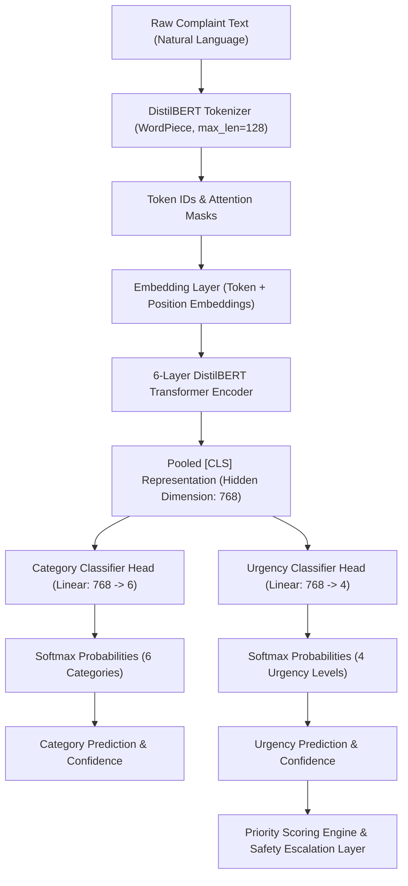

# Deep-Dive Model Architecture & Edge NLP Engineering
## Edge-Based Hostel Maintenance Complaint Prioritization System

---

## 1. Architectural Overview

The core Natural Language Processing engine employs **DistilBERT** (`distilbert-base-uncased`), an encoder-based Transformer model distilled from BERT (Bidirectional Encoder Representations from Transformers).

---

## 2. DistilBERT vs. BERT-Base vs. Autoregressive Decoders (GPT)

| Feature | DistilBERT (Used in Project) | BERT-Base | GPT (Decoder-Only) |
| :--- | :--- | :--- | :--- |
| **Model Type** | Bidirectional Encoder | Bidirectional Encoder | Autoregressive Decoder |
| **Layers (Blocks)** | **6** | 12 | 12 - 96 |
| **Attention Heads** | **12** | 12 | 12 - 96 |
| **Hidden Dimension** | **768** | 768 | 768 - 12288 |
| **Total Parameters** | **66,958,086 (~67M)** | 110,000,000 (~110M)| 125M - 175B+ |
| **Edge Feasibility** | **High (Runs in ~44ms on CPU)** | Moderate | Low (Requires GPU/High RAM) |
| **Attention Mechanism** | **Bidirectional** (All tokens attend to all) | Bidirectional | Causal Masked (Only past tokens) |
| **Task Suitability** | **Ideal for Sequence Classification** | Ideal for Classification | Ideal for Text Generation |

### Why an Encoder-Based Model is Optimal for Complaint Prioritization:
1. **Bidirectional Context:** In complaint descriptions such as *"Water is leaking near the electrical box"*, the urgency of *"Water is leaking"* depends critically on the subsequent tokens (*"near the electrical box"*). An encoder attends in both directions across the sequence, creating rich contextual representations of risk.
2. **Deterministic Confidence Scores:** The sequence classification head produces normalized softmax distributions over fixed categories and urgency classes, preventing generative hallucinations.
3. **Edge Resource Footprint:** At 66.9 million parameters and ~256 MB memory footprint, DistilBERT executes on consumer CPUs in under 45 milliseconds without requiring GPU acceleration or paid cloud subscriptions.

---

## 3. Mathematical Foundations of Attention

### Multi-Head Self-Attention
For an input sequence embedded into matrix $X \in \mathbb{R}^{n \times d}$, each Transformer layer computes queries, keys, and values using learnable projection weights:
$$Q = X W^Q, \quad K = X W^K, \quad V = X W^V$$
Where $W^Q, W^K, W^V \in \mathbb{R}^{d \times d_k}$.

The scaled dot-product attention computes compatibility between token queries and keys:
$$\text{Attention}(Q, K, V) = \text{softmax}\left(\frac{Q K^T}{\sqrt{d_k}}\right) V$$
Dividing by $\sqrt{d_k}$ prevents the dot products from growing excessively large in high dimensions, preventing gradients from vanishing during softmax computation.

Multi-Head Attention expands this by computing $h = 12$ distinct projections in parallel:
$$\text{MultiHead}(Q, K, V) = \text{Concat}(\text{head}_1, \dots, \text{head}_h) W^O$$

---

## 4. Knowledge Distillation Mechanics

DistilBERT was compressed from BERT-Base using a triple loss function during pretraining:
$$L_{\text{distil}} = \alpha L_{\text{ce}} + \beta L_{\text{mlm}} + \gamma L_{\text{cos}}$$
1. **Soft Distillation Loss ($L_{\text{ce}}$):** Cross-entropy between the student's softmax distribution and the teacher's soft probability targets (temperature $T=2$).
2. **Masked Language Modeling Loss ($L_{\text{mlm}}$):** Hard cross-entropy on masked token prediction.
3. **Cosine Embedding Loss ($L_{\text{cos}}$):** Aligns the direction of the student and teacher hidden state vectors.

---

## 5. Dual Fine-Tuned Classification Heads

### Model 1: Category Classifier
- **Input:** Tokenized complaint string ($n \le 128$).
- **Head:** Linear layer $W_{\text{cat}} \in \mathbb{R}^{768 \times 6}$ + Bias $b_{\text{cat}} \in \mathbb{R}^6$.
- **Classes:**
  0. Water and Plumbing
  1. Electrical
  2. Internet and Wi-Fi
  3. Cleanliness and Sanitation
  4. Furniture and Civil Maintenance
  5. Other

### Model 2: Urgency Classifier
- **Input:** Tokenized complaint string ($n \le 128$).
- **Head:** Linear layer $W_{\text{urg}} \in \mathbb{R}^{768 \times 4}$ + Bias $b_{\text{urg}} \in \mathbb{R}^4$.
- **Classes:**
  0. Critical
  1. High
  2. Medium
  3. Low

---

## 6. Documented Parameter-Efficient Alternatives (PEFT)

While full fine-tuning of the classification head and top encoder layers was implemented, the following parameter-efficient fine-tuning (PEFT) techniques are theoretically acknowledged for even lower-resource environments:
1. **LoRA (Low-Rank Adaptation):** Decomposes weight update matrices $\Delta W$ into low-rank matrices $B \times A$ where $r \ll d$. Reduces trainable parameters by ~99%.
2. **Adapter Tuning:** Inserts small residual bottleneck feed-forward layers between Transformer sub-layers while freezing base weights.
3. **Prompt Tuning / Prefix Tuning:** Prepends virtual learnable continuous embedding tokens to input keys and values while freezing the entire backbone model.
