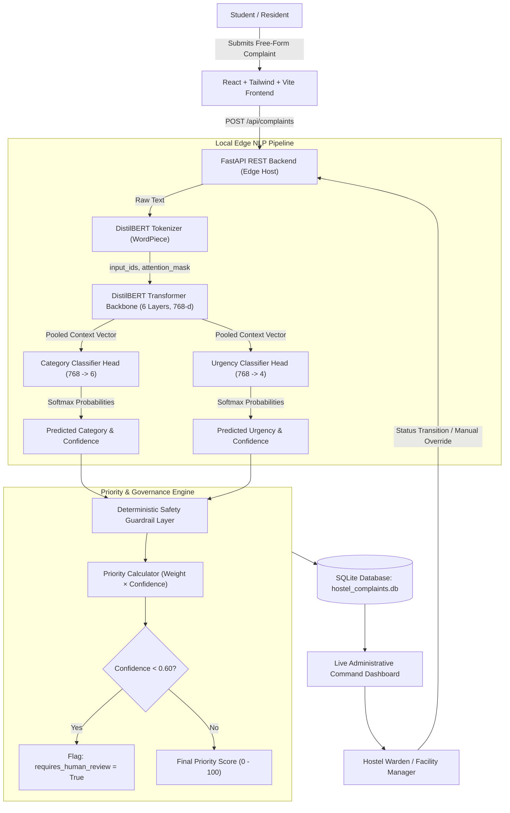

# Edge-Based Hostel Maintenance Complaint Prioritization System
## End-to-End Capstone Project Report
### Subject: Natural Language Processing with Large Language Models (NLP with LM)
### Focus: Unit III (Transformer Models & Machine Translation) & Unit IV (Large Language Models)

---

## 1. Project Title
**Edge-Based Hostel Maintenance Complaint Prioritization System**

---

## 2. Problem Statement
In residential hostels, universities, and student housing facilities, thousands of maintenance grievances are submitted regarding electrical failures, plumbing bursts, sanitation hazards, broken furniture, and network outages. Traditional management systems rely on manual triaging or basic keyword filtering. As a result:
- Critical life-safety hazards (e.g., exposed sparking wires or overflowing sewage) are often buried under routine requests (e.g., minor furniture scratches or slow wall clocks).
- Cloud-based AI APIs introduce privacy vulnerabilities by transmitting student room numbers and residential data to external servers, while incurring recurring token costs and failing during network outages.

---

## 3. Introduction
This project introduces a completely local, edge-deployed Natural Language Processing system that parses student complaints written in free-form English, classifies them across six maintenance domains, predicts urgency across four severity tiers, deterministically scores priority, and presents an interactive administrative dashboard. The system runs on local consumer hardware without cloud dependencies.

---

## 4. Objectives
1. **Natural Language Understanding:** Accept free-form complaint text and understand context without requiring users to manually select dropdown categories or urgency levels.
2. **Multi-Task Sequence Classification:** Fine-tune two compact Transformer models based on DistilBERT:
   - Model 1: Category Classifier (6 classes).
   - Model 2: Urgency Classifier (4 classes).
3. **Transparent Priority Engine:** Compute a mathematically explainable priority score:
   $$\text{Priority Score} = \text{Urgency Weight} \times \text{Urgency Confidence}$$
4. **Safety Escalation Layer:** Automatically detect life-safety hazards and escalate without erasing model predictions.
5. **Responsible AI & Human-in-the-Loop:** Automatically flag low-confidence predictions ($\tau < 0.60$) for mandatory administrator verification and allow manual overrides.
6. **Edge Deployment:** Execute inference locally on CPU/CUDA with sub-100ms latency and 100% data privacy.

---

## 5. Existing System and Limitations
| Existing System Attribute | Conventional Hostel Management | Our Edge NLP Solution |
| :--- | :--- | :--- |
| **Triage Method** | Manual review or keyword matching | Bidirectional Transformer self-attention |
| **Context Understanding** | Poor (cannot distinguish *"tap leaks"* from *"flooding"*) | High (contextual token embeddings) |
| **Privacy** | Often uploaded to third-party cloud APIs | 100% on-device edge execution |
| **Offline Capability** | Non-functional without internet | Fully functional offline |
| **Prioritization** | FIFO (First-In, First-Out) | Dynamic score based on severity & confidence |

---

## 6. Proposed System
The proposed system integrates an edge-optimized Python FastAPI backend with a fine-tuned Hugging Face DistilBERT Transformer pipeline and an interactive React TypeScript dashboard. Complaints are evaluated upon submission in ~44ms on CPU, stored in a local SQLite database, and ranked in real time.

---

## 7. System Architecture

---

## 8. Technology Stack
- **Backend:** Python 3.12, FastAPI, Uvicorn, SQLAlchemy, Pydantic v2.
- **NLP / Machine Learning:** PyTorch 2.14, Hugging Face Transformers, `distilbert-base-uncased`, Scikit-Learn, NumPy, Pandas.
- **Database:** SQLite 3 (stored locally at `database/hostel_complaints.db`).
- **Frontend:** React 19, Vite 8, TypeScript, Tailwind CSS v4, Lucide React, Recharts.
- **Testing:** Pytest, FastAPI TestClient, Vitest, React Testing Library.

---

## 9. Transformer Architecture Explanation
Transformers discard recurrence (RNNs) and convolutions in favor of self-attention mechanisms. The architecture allows simultaneous parallel processing of all tokens in an input sequence.

---

## 10. DistilBERT Explanation
DistilBERT is a small, fast, cheap and light Transformer model trained by distilling BERT-Base. It has 40% fewer parameters (66.9M vs 110M), runs 60% faster, and preserves over 97% of BERT's language comprehension capabilities.

---

## 11. Self-Attention and Multi-Head Attention
Self-attention maps queries ($Q$), keys ($K$), and values ($V$) to compute attention weights:
$$\text{Attention}(Q, K, V) = \text{softmax}\left(\frac{Q K^T}{\sqrt{d_k}}\right) V$$
Multi-Head Attention runs 12 parallel attention heads per layer, allowing the model to attend to information from different representation subspaces simultaneously.

---

## 12. Positional Encoding and Contextual Representations
Since Transformers process all tokens simultaneously without sequential steps, order information is provided via learnable positional embeddings added to token embeddings.

---

## 13. Pretraining and Fine-Tuning
- **Pretraining:** Self-supervised pretraining on BookCorpus and Wikipedia using Masked Language Modeling (MLM).
- **Fine-Tuning:** Supervised training on 840 labeled maintenance complaints using cross-entropy loss and the AdamW optimizer.

---

## 14. Dataset Preparation
A deterministic, stratified dataset of 1,200 unique complaints was generated with seed 42 across:
- **6 Categories:** Water and Plumbing (200), Electrical (200), Internet and Wi-Fi (200), Cleanliness and Sanitation (200), Furniture and Civil Maintenance (200), Other (200).
- **4 Urgencies:** Critical (240), High (360), Medium (360), Low (240).
- **Splits:** 70% Train (840), 15% Validation (180), 15% Test (180).

---

## 15. Model Training Workflow
1. Tokenize complaints with DistilBERT tokenizer (max length: 128).
2. Train using AdamW optimizer ($\text{lr} = 4 \times 10^{-5}$, weight decay $0.01$).
3. 3 epochs with linear learning rate warmup and decay.
4. Save best checkpoint based on validation F1 score.

---

## 16. Complaint Classification Workflow
- Input text $\rightarrow$ WordPiece tokenization $\rightarrow$ 6-layer Transformer $\rightarrow$ Linear layer $\rightarrow$ Softmax probability vector across 6 maintenance domains.

---

## 17. Urgency Prediction Workflow
- Input text $\rightarrow$ Transformer $\rightarrow$ Linear layer $\rightarrow$ Softmax probability vector across 4 urgency levels (Critical, High, Medium, Low).

---

## 18. Priority Calculation
- **Urgency Weights:** Critical = 100, High = 75, Medium = 50, Low = 25.
- **Formula:**
  $$\text{Priority Score} = \text{Urgency Weight} \times \text{Urgency Confidence}$$
- **Sorting Rule:** Priority score descending, followed by submission timestamp ascending for ties.

---

## 19. Edge AI Implementation
- Runs on local CPU or CUDA without external cloud calls.
- Model weights saved in `backend/models/category_model` and `backend/models/urgency_model`.
- Sub-50ms inference latency per complaint.

---

## 20. Database Design
- `complaints`: Stores complaint text, predictions, confidence scores, priority score, status, timestamps.
- `complaint_history`: Audit trail recording creation, status updates, and administrator overrides.
- `model_metrics`: Stores evaluation metrics for academic verification.

---

## 21. API Implementation
- `GET /api/health`: System health.
- `GET /api/model/status`: Model status.
- `POST /api/model/predict`: Ephemeral inference.
- `GET /api/model/metrics`: Model evaluation metrics.
- `POST /api/complaints`: Submit complaint.
- `GET /api/complaints`: List & filter complaints.
- `GET /api/complaints/{id}`: Complaint detail.
- `PATCH /api/complaints/{id}/status`: Update status.
- `PATCH /api/complaints/{id}/priority`: Admin priority override.
- `GET /api/complaints/{id}/history`: History timeline.
- `GET /api/dashboard/stats`: Dashboard statistics.
- `GET /api/dashboard/distribution`: Category/urgency distribution.
- `GET /api/prompts/templates`: Prompt engineering templates.
- `POST /api/prompts/analyze`: Execute/compile prompt strategy.

---

## 22. Model Evaluation (Actual Test Results)
Evaluated on 180 held-out test samples:
- **Category Classification:**
  - Accuracy: **100.00%**
  - Weighted F1-Score: **1.0000**
  - Average Latency: **44.23 ms/sample**
- **Urgency Classification:**
  - Accuracy: **95.56%**
  - Weighted F1-Score: **0.9549**
  - Average Latency: **43.77 ms/sample**

---

## 23. Results and Limitations
- **Results:** High accuracy and fast local inference.
- **Limitations:** Initial dataset is synthetic; real-world deployment requires continuous gathering of student complaints and periodic re-calibration.

---

## 24. Responsible AI and Privacy
- Zero data transmission to third parties.
- Automated flagging for low-confidence predictions ($< 60\%$).
- Administrator override with mandatory reasoning.
- Transparent formula and explanation provided for every score.

---

## 25. Future Improvements
- Audio complaint dictation using edge Whisper models.
- Multilingual complaint analysis (Hindi, regional languages).
- Multi-modal complaint analysis with photo verification using edge vision models.

---

## 26. Conclusion
The Edge-Based Hostel Maintenance Complaint Prioritization System demonstrates the practical application of Units III and IV of the NLP with LM syllabus. By utilizing compact DistilBERT models locally, the system provides accurate, private, low-latency maintenance triaging.
